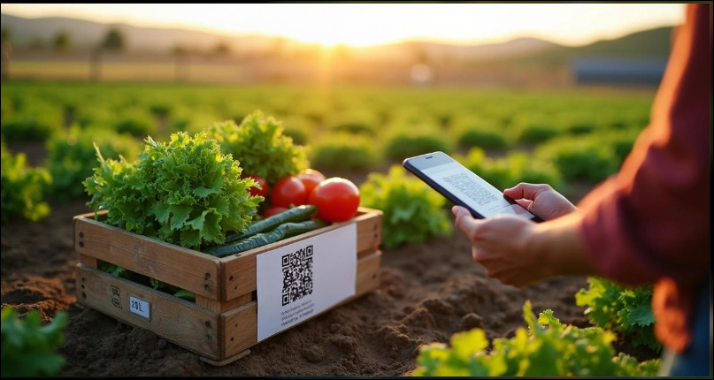
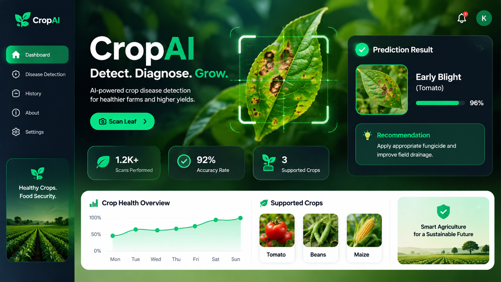

# Gatmach Yuol — Personal Portfolio

A personal portfolio showcasing my journey as a Computer Science graduate, technical interests, selected projects, achievements, and creative services.

Built to reflect my passion for software engineering, artificial intelligence, innovation, and developing technology that solves real-world problems.

## About Me

I am a Computer Science graduate passionate about technology, innovation, and transforming ideas into practical digital solutions.

My technical interests include:

- Software Engineering
- Artificial Intelligence
- Machine Learning & Data Science
- Computer Networking
- Cybersecurity
- Innovation & Problem Solving

I am driven by curiosity, continuous learning, and the desire to use technology to address real-world challenges.

## Portfolio Sections

- **Home** — Introduction and overview.
- **About** — Background, education, and professional interests.
- **Expertise** — Technical skills and areas of focus.
- **Projects** — Selected software and technology projects.
- **Creative Services** — Design and creative work.
- **Achievements** — Academic recognition, professional development, and leadership.
- **Contact** — Ways to connect and collaborate.

## Featured Projects

### 1. WasteOS

A smart waste management system designed to support efficient waste collection, monitoring, and management.


[View on GitHub](https://github.com/Gatmach/SWM-System)

### 2. Farm2Fork

A blockchain-based agricultural traceability solution designed to improve transparency and traceability in the agricultural supply chain.



[View on GitHub](https://github.com/Farmtfork)

### 3. CropAI

An AI-powered crop disease diagnosis project using machine learning and image classification to identify crop diseases.



[View on GitHub](https://github.com/Gatmach/ai-crop-disease-diagnosis)

### 4. Feelr

A software project exploring digital solutions and user-focused application development.


[View on GitHub](https://github.com/Gatmach/feeler)

## Technology Stack

- **Frontend:** React, TypeScript, Vite
- **Styling:** CSS Modules and modern CSS
- **Development Tools:** ESLint, Git, and GitHub

## Getting Started

### Prerequisites

- Node.js
- npm

### Installation

Clone the repository:

```bash
git clone YOUR_REPOSITORY_URL
```

Navigate to the project directory:

```bash
cd YOUR_PROJECT_DIRECTORY
```

Install dependencies:

```bash
npm install
```

Start the development server:

```bash
npm run dev
```

Build the application for production:

```bash
npm run build --workspace=client
```

## Design Philosophy

The portfolio follows a clean, modern, and responsive design approach, featuring:

- Deep navy and blue tones.
- Red accents and clean white backgrounds.
- Montserrat, Inter, and JetBrains Mono typography.
- Responsive layouts for different screen sizes.
- Smooth visual transitions and interactive elements.
- Clear navigation and focused content presentation.
- Consistent project imagery and visual storytelling.

## Connect With Me

- **GitHub:** [Gatmach](https://github.com/Gatmach)
- **LinkedIn:** [Gatmach Yuol Nyuon](https://www.linkedin.com/in/gatmachyuolnyuon/)

## License

This repository contains my personal portfolio, project presentations, and original design assets. Please contact me before reusing its original content or design materials.

---

**Technology with purpose. Solutions with impact.**